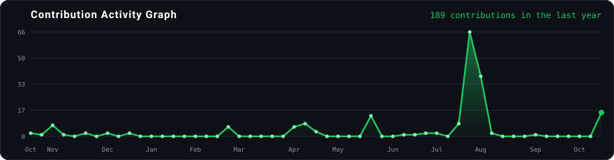

 

  

 

  
  
  
  

 

  <h2><b>ABOUT ME</b></h2>
  

I'm a **Full-Stack MERN Developer** focused on building practical web applications, scalable APIs, interactive dashboards, and automation tools.

My interests include **AI & RAG pipelines, reverse engineering, cybersecurity, ethical hacking, and bug hunting**. I enjoy exploring how systems work under the hood and turning ideas into useful, real-world applications.

I work across **web and mobile development, backend engineering, data extraction workflows, AI integrations, and real-time applications**, with an emphasis on usability, performance, and maintainable code.

Currently exploring **Kubernetes, DevOps, and cloud-native deployment** to build, ship, and scale applications more effectively.

🤝 **Open to collaborating on:** Full-stack development, AI-powered applications, RAG systems, PHP projects, mobile apps, developer tools, and security research.

🔐 I practice security research responsibly, focusing on systems I own, have explicit permission to test, or that are intentionally designed for security testing.

 

  <h2><b>GITHUB STATS</b></h2>
  

  

 

  

 

  

 

  <h2><b>CONTRIBUTION GRAPH</b></h2>
  

  
    
  <picture>
    <source media="(prefers-color-scheme: dark)" srcset="https://raw.githubusercontent.com/anjan-budige/anjan-budige/output/github-contribution-grid-snake-dark.svg" />
    <source media="(prefers-color-scheme: light)" srcset="https://raw.githubusercontent.com/anjan-budige/anjan-budige/output/github-contribution-grid-snake.svg" />
    
  </picture>

 

  <h2><b>PINNED REPOSITORIES</b></h2>
  

Node.js / Express + PostgreSQL backend powering the Diya music app with JWT auth, collaborative playlists and listening analytics. 
Socket.IO drives real-time multi-user Vibe Sessions for synchronized listening across 30+ REST endpoints.

 

Full-stack MERN academic platform with separate Admin, Faculty and Student portals behind role-based JWT access control. 
Course / batch / user management, task submission and grading, plus a Recharts analytics dashboard with PDF report export.

 

React music-discovery app that live-scrapes JioSaavn and Gaana for search, genre suggestions and streaming links. 
Mobile-first UI with dark mode and Bluetooth hardware-button navigation, deployed live on Netlify.

 

Banking support chatbot trained on a structured intents dataset with NLTK preprocessing and a PyTorch feed-forward network. 
Served as a CORS-enabled Flask prediction API with a decoupled HTML/JS frontend, or runnable in console via chat.py.

 

Streamlit + YOLOv11 + OpenCV tool that detects and counts vehicles from uploaded videos or live camera feeds in real time. 
Classifies traffic as Rush / No-Rush from vehicle density and streams live statistics on a web dashboard.

 

  <h2><b>SKILLS & TECHNOLOGIES</b></h2>
  

### Languages

### Full Stack

### Mobile & App Development

### Security, DevOps & Tools

 

  <h2><b>CURRENT FOCUS</b></h2>
  

Building production-style **MERN** applications with clean APIs and responsive user interfaces.

Practicing **web security testing**, recon, responsible bug hunting, and reverse-engineering fundamentals.

Developing **mobile-friendly products** and improving deployment workflows with DevOps tooling.

Exploring AI-assisted tools, automation, traffic analysis, and data-driven applications.

 

---

  <h3>Let's Connect & Collaborate</h3>
  
Reach out for full-stack projects, mobile apps, AI tools, security research, or collaboration ideas.

  

    

  

    
  

